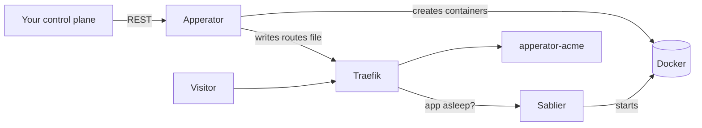

# Apperator

**Give every customer their own instance of your app, without paying for hundreds of idle servers.**

Say you've built an app that ships as a Docker image, and now you want to sell it as a hosted service. You have two choices. Rewrite it as a multi-tenant SaaS, with a tenant ID on every query and one bug away from showing one customer another customer's data. Or run one copy per customer, which is simple and safe, until you notice that 300 customers means 300 containers sitting in memory, mostly doing nothing.

Apperator makes the second choice cheap. It runs one container per customer on your own server, and puts the idle ones to sleep. A sleeping app uses no memory and no CPU. When a request comes in, it wakes up and answers, and the visitor just sees a slow first response. No redirect, no "starting…" page, no lost request.

It's for developers who want to:

- **Host their open-source or self-hosted app as a paid service**, running the same image their users run.
- **Give each customer real isolation**: their own process, database, volume and subdomain.
- **Run many small, mostly idle apps** (per-customer instances, per-team tools, demo and preview environments) on one modest server.

You talk to it with one REST call. Send an image, some environment variables and a hostname, and Apperator does the rest: the container, the route, the TLS certificate, the volume, the health check, the idle stop, the wake-up.

```bash
curl -X PUT http://127.0.0.1:7070/v1/apps/acme \
  -H "Authorization: Bearer $APPERATOR_TOKEN" \
  -H "Content-Type: application/json" \
  -d '{
    "image": "ghcr.io/example/app:1.4",
    "env": { "PUBLIC_URL": "https://acme.example.com" },
    "hostnames": ["acme.example.com"],
    "port": 3000,
    "health_path": "/health",
    "data_path": "/data",
    "memory_mb": 384,
    "idle_timeout": "15m",
    "wake_file": "/data/next-work-at"
  }'
```

The call returns once `/health` answers, and `https://acme.example.com` is live. After 15 quiet minutes the container stops. The next visitor wakes it.

| | |
|---|---|
| Memory of a sleeping app | **0 MB** |
| First request to a sleeping app | **~2.2 s** for a Node.js app that boots in 1.6 s |
| New app reachable after `PUT` | **~0.3 s** |
| Apperator itself | **~10 MB** image, **~12 MB** of memory, one static Go binary |
| Apps keep working while Apperator is down | **Yes** |

Measured on a 2-core cloud server. Your wake time is mostly your app's boot time.

## Why one container per customer

Each customer gets their own process, database and volume. A bug can't leak one customer's data to another, deleting a customer means deleting one volume, and your hosted service runs the very same image your self-hosters run. The only real cost was memory: an idle container still holds 50–150 MB. Apperator removes that cost, so a small server can hold hundreds of customers as long as the ones awake at the same moment fit in memory.

### Why not…

- **Kubernetes with Knative** scales to zero too, but you have to run Kubernetes. Apperator needs Docker and nothing else.
- **A hosted platform with auto-stop** works until you want your own servers, your own region or your own bill.
- **A PaaS like Dokku or Coolify** deploys apps well, but it's built for a handful of long-running apps, not hundreds of sleeping copies managed by your code.

## How it fits together

Apperator doesn't proxy traffic or start containers itself on the request path. It sets things up and steps aside. Proven tools do the live work:



- **Docker** runs the containers.
- **[Traefik](https://traefik.io)** routes each hostname to its container and gets the certificates.
- **[Sablier](https://github.com/sablierapp/sablier)** stops idle containers and holds the first request while a sleeping one starts.
- **Apperator** gives you the API, writes Traefik's routes, sets up Sablier and the health checks, wakes apps on schedule, limits how many start at once, and sends webhooks.

Because of that split, Apperator can restart, crash or be upgraded and your customers won't notice. See [When Apperator is down](#when-apperator-is-down).

It knows nothing about your customers, plans or billing. Your own code calls the API and keeps that logic.

## Features

- **Declarative.** `PUT` the app you want. Apperator creates the container, or recreates it when the image or settings changed. The same request twice changes nothing.
- **Data survives.** Each app has a named volume, kept when the container is recreated or the app is deleted. Deleting the data is a separate, explicit call.
- **Scale to zero.** With `idle_timeout`, the app stops after that long without requests and starts on the next one.
- **Exact wake-ups.** A sleeping app can't run its own timers, so reminders and scheduled jobs would wait forever. With `wake_file`, the app writes the next time it has work (an RFC 3339 time) to a file in its data folder. Apperator reads it from the stopped container and wakes the app on time. As a safety net, sleeping apps also wake once a day.
- **Health checks in any image.** With `health_path`, Apperator copies its own tiny probe into the container and makes it Docker's health check. It works even in images without `curl`, and a waking request only goes through once the app really answers. If the app exits or never gets healthy, the error includes its last log lines.
- **No wake storms.** Apps start a few at a time (`APPERATOR_MAX_STARTING`), so a reboot or a burst of wake-ups can't use up the host's memory. Sleeping apps don't all start after a reboot: they wait for a request.
- **One-off commands.** `POST /v1/apps/{id}/exec` runs a command in the app, waking it first if needed. Handy for migrations and setup scripts.
- **Webhooks.** Signed events when apps are created, started, stopped, run out of memory, fail to start or are deleted.
- **Clean goodbyes.** `APPERATOR_FALLBACK_URL` sends visitors of a deleted app's hostname somewhere useful instead of an error.
- **Small.** One static Go binary, standard library only.

## Quick start

You need a Linux server with Docker 25 or later, and a domain whose DNS points at it.

```bash
git clone https://github.com/automazeio/apperator
cd apperator
export APPERATOR_TOKEN=$(openssl rand -hex 32)
export ACME_EMAIL=you@example.com APPERATOR_CERT_RESOLVER=letsencrypt
docker compose -f deploy/compose.yaml up -d
```

That's it. This starts Traefik on ports 80 and 443 (with Let's Encrypt certificates), Sablier and Apperator. The API listens on `127.0.0.1:7070`. Keep it private: reach it over a VPN or an SSH tunnel, never from the open internet.

Then create an app with the `curl` call above. See [docs/api.md](docs/api.md) for every endpoint and field.

To try it on your laptop without HTTPS:

```bash
APPERATOR_ENTRYPOINTS=web APPERATOR_TLS=false docker compose -f deploy/compose.yaml up -d
```

Hostnames under `.localhost`, such as `demo.localhost`, resolve to your machine in most browsers.

## How waking works

Apperator writes Traefik's routes to a file, and Traefik picks up each change within milliseconds. Each route points at the app's name on the Docker network, such as `http://apperator-acme:3000`. That address stays the same while the app sleeps, so Traefik doesn't need to reload when it wakes.

1. A request arrives for a sleeping app. Traefik passes it to the Sablier plugin.
2. Sablier starts the container and holds the request until Docker reports it healthy. With `health_path`, Apperator's own probe does that check; without it, the image's own health check does, and with neither, the request goes through as soon as the container runs, which can be before the app listens. Docker runs the check every 250 ms while the app starts, and the Compose stack has Sablier look every 250 ms (both default to 5 s).
3. The request goes on to the app. The client sees a slow response, not a redirect or an error.

How long this takes depends mostly on how fast your app boots. A Node.js app that boots in about 1.6 s answered its first request in about 2.2 s on a 2-core server. Several apps waking at once share the CPU, so six of them took about 14 s each on the same server. A new app gets its route as soon as `PUT` has created it.

Scheduled wake-ups go through Sablier's API too, so Sablier's idle timer applies to them in the same way.

## Configuration

Apperator reads its settings from environment variables.

| Variable | Default | Description |
|---|---|---|
| `APPERATOR_TOKEN` | – | Required. The API's bearer token, at least 32 characters. |
| `APPERATOR_LISTEN` | `:7070` | The API's address. |
| `APPERATOR_DATA_DIR` | `/var/lib/apperator` | Where app specs are kept (one JSON file per app). They include environment variables, so keep the folder private. |
| `DOCKER_HOST` | `unix:///var/run/docker.sock` | The Docker daemon. |
| `APPERATOR_NETWORK` | `apperator` | The Docker network shared by apps, Traefik and Sablier. Created if missing. |
| `APPERATOR_PREFIX` | `apperator-` | Prefix for container and volume names. App `acme` runs as `apperator-acme` with the volume `apperator-acme-data`. |
| `APPERATOR_ROUTER` | `traefik` | `traefik` writes routes for Traefik's file provider. `none` writes none, for running your own proxy. |
| `APPERATOR_ROUTES_FILE` | `/routes/apperator.yml` | Where Apperator writes Traefik's routes. Share its folder with Traefik (`--providers.file.directory`, `--providers.file.watch=true`). The name must end in `.yml` or `.yaml`. |
| `APPERATOR_ENTRYPOINTS` | `websecure` | Traefik entrypoints for app routes. |
| `APPERATOR_TLS` | `true` | Serve app routes over TLS. |
| `APPERATOR_CERT_RESOLVER` | – | Traefik certificate resolver, for example `letsencrypt`. |
| `APPERATOR_FALLBACK_URL` | – | Where requests for a hostname with no app are redirected, for example a deleted app's old address. Off when empty. HTTPS needs a certificate Traefik already has, such as a wildcard. |
| `APPERATOR_SABLIER_URL` | – | Sablier's address, for example `http://sablier:10000`. Required for `idle_timeout`. |
| `APPERATOR_SABLIER_TIMEOUT` | `30s` | How long a request waits for a sleeping app to start. |
| `APPERATOR_START_TIMEOUT` | `60s` | How long a start may take before it fails. |
| `APPERATOR_STOP_TIMEOUT` | `20` | Seconds an app has to shut down before it is killed. |
| `APPERATOR_MAX_STARTING` | `4` | How many apps may start at once. |
| `APPERATOR_MAX_RUNNING` | `0` | Scheduled wake-ups wait while this many apps run. `0` means no cap. |
| `APPERATOR_SAFETY_WAKE` | `24h` | Wake a sleeping app this long after it stopped, even without a wake file. `0` turns it off. |
| `APPERATOR_TICK` | `30s` | How often wake-ups are checked. |
| `APPERATOR_WEBHOOK_URL` | – | Where events are sent. |
| `APPERATOR_WEBHOOK_SECRET` | – | Signs events. Required with a webhook URL. |
| `APPERATOR_PROBE_BINARY` | this binary | A static Linux build of Apperator, copied into apps with `health_path` to run their health check. `off` turns this off. The official image needs no change. |
| `APPERATOR_REGISTRY_AUTH` | – | An `X-Registry-Auth` value for pulling private images. |
| `APPERATOR_LOG_FORMAT` | `text` | `text` or `json`. |

## When Apperator is down

Apperator only manages apps. Traefik and Sablier serve them. While Apperator is down or restarting, for example during an upgrade, running apps keep answering, and requests still wake sleeping apps and they still stop when idle. The routes file stays where it is, even if Traefik restarts. Only the API, scheduled wake-ups and webhooks wait until Apperator is back.

To catch a bad setting before it stops Apperator from starting, run `check` with the new settings before you deploy. It tests the settings, Docker and the folders, and exits:

```bash
docker compose -f deploy/compose.yaml run --rm --no-deps apperator check
```

## Security

- The API can run any image with any settings on your server, which is close to root access. Treat the token like a root password and keep the API off the public internet.
- Apperator and Sablier need the Docker socket. Traefik doesn't: it reads its routes from a file, through a read-only mount.
- Every hostname that gets its own certificate is published in public Certificate Transparency logs, and bots start scanning it within minutes. Each scan wakes a sleeping app. A wildcard certificate (a DNS challenge in Traefik) keeps your customers' hostnames out of those logs.
- Apps run with `no-new-privileges`, a process limit and your memory and CPU limits. They share one Docker network, so an app can reach the others: use a firewall inside your apps, or one Apperator per trust boundary, if that matters to you.

## Status

Apperator is new. The API may change before 1.0. It runs on one host. Spreading apps across several hosts is up to the caller for now: run one Apperator per host and keep track of which app lives where.

## Development

```bash
go test ./...                              # unit tests
APPERATOR_DOCKER_TESTS=1 go test ./...      # also run an app through its life on real Docker
go build -o apperator ./cmd/apperator
```

## Licence

Apache-2.0. Copyright 2026 [Automaze](https://github.com/automazeio). Apperator runs Traefik (MIT) and Sablier (AGPL-3.0) as separate, unchanged programs.
